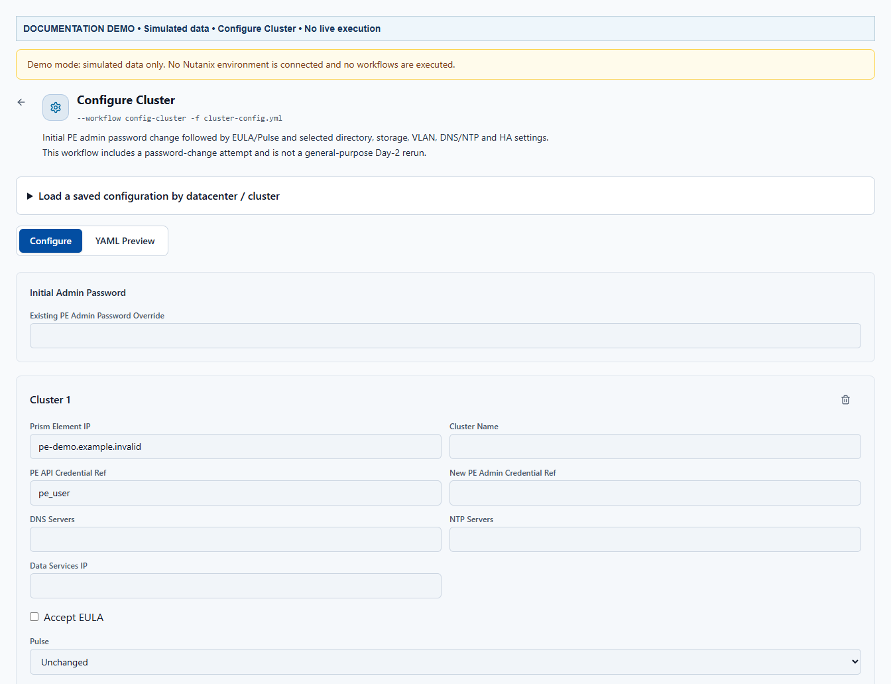

# Configure Cluster Quick Guide

Guide ID: `QG-W-config-cluster` · Reviewed: 21 November 2026 · Source: `48eb875`

Status: Current source procedure. Read [Using the quick guides](../using-the-guides.md) first.

## Purpose

Initial cluster configuration: admin password, EULA/Pulse, networking and storage.

## Prerequisites

Use the role authorized by the installed workflow policy. Complete the common preparation checklist, confirm service health and review the impact/recovery plan for this target.

## Required inputs

Configuration filename: `cluster-config.yml`. Each PE VIP, cluster name and verified credential references; authorized EULA/Pulse choice and only required DNS/NTP/DSIP/HA/storage/VLAN changes.

## Procedure

1. Open Workflows 1.x → Configure Cluster; confirm the ID is config-cluster.
2. Review the password stage before generating YAML. A combined first-time run changes the PE admin password first. If already changed, later files must omit new_pe_admin_credential and use the verified replacement pe_credential.
3. Inspect the full generated/imported YAML, including optional settings and target scope. Save the reviewed file; perform the supported validation before submission.
4. Use the action's required approval and confirmation path. Submit once and follow Jobs / Queue plus any remote service task to its documented completion.

## Validation and expected result

Verify replacement PE login where applicable, then independently compare every selected property and final health in Prism.

## Failure and recovery

Not an unrestricted Day-2 rerun. Avoid repeating password changes; existing-password overrides are sensitive plaintext in YAML. Inspect partial completion before retry.

## Evidence to capture

Record the exact target, installed build, reviewed config filename/hash, approval if applicable, job/task/run IDs and redacted before/after checks. Keep unresolved follow-up with the change record.

## References

- [Detailed procedure](../../cluster-initial-configuration.md)
- [Catalogue and details](../../../src/data.ts)
- [Execution form](../../../src/pages/WorkflowDetail.tsx)
- [Guide index](../README.md)

## Screen reference

Simulated initial/authoring view captured 21 November 2026 from application source `48eb875`. State: **Configure / initial draft** at `/workflows/config-cluster`. Values are synthetic and required inputs may be incomplete. This is not evidence of a successful run, live target authentication or hardware compatibility. Lower form sections may be outside the captured viewport. Follow the preparation, approval, verification and recovery instructions.
