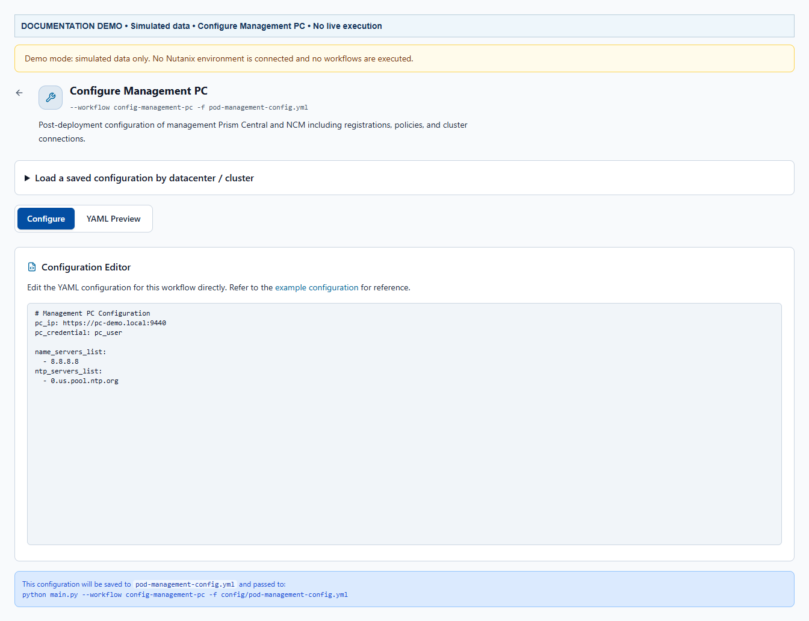

# Configure Management PC Quick Guide

Guide ID: `QG-W-config-management-pc` · Reviewed: 21 November 2026 · Source: `48eb875`

Status: Current source procedure. Read [Using the quick guides](../using-the-guides.md) first.

## Purpose

Initializes and configures Prism Central and NCM.

## Prerequisites

Use the role authorized by the installed workflow policy. Complete the common preparation checklist, confirm service health and review the impact/recovery plan for this target.

## Required inputs

Configuration filename: `pod-management-config.yml`. Healthy management PC/NCM, matching management configuration YAML, PC credential reference, DNS/NTP and registrations/policies in scope.

## Procedure

1. Open Workflows 1.x → Configure Management PC; confirm the ID is config-management-pc.
2. Review the editor's starter and supply only settings supported by the installed workflow. Validate endpoints and intended registration scope before execution.
3. Inspect the full generated/imported YAML, including optional settings and target scope. Save the reviewed file; perform the supported validation before submission.
4. Use the action's required approval and confirmation path. Submit once and follow Jobs / Queue plus any remote service task to its documented completion.

## Validation and expected result

Confirm DNS/NTP and each requested management-plane registration/policy from the target service.

## Failure and recovery

This is post-deployment configuration, not PC/NCM deployment. Confirm existing state before repeating registration or policy actions.

## Evidence to capture

Record the exact target, installed build, reviewed config filename/hash, approval if applicable, job/task/run IDs and redacted before/after checks. Keep unresolved follow-up with the change record.

## References

- [Detailed procedure](../../user-guide.md)
- [Catalogue and details](../../../src/data.ts)
- [Execution form](../../../src/pages/WorkflowDetail.tsx)
- [Guide index](../README.md)

## Screen reference

Simulated initial/authoring view captured 21 November 2026 from application source `48eb875`. State: **Configure / initial draft** at `/workflows/config-management-pc`. Values are synthetic and required inputs may be incomplete. This is not evidence of a successful run, live target authentication or hardware compatibility. Lower form sections may be outside the captured viewport. Follow the preparation, approval, verification and recovery instructions.
