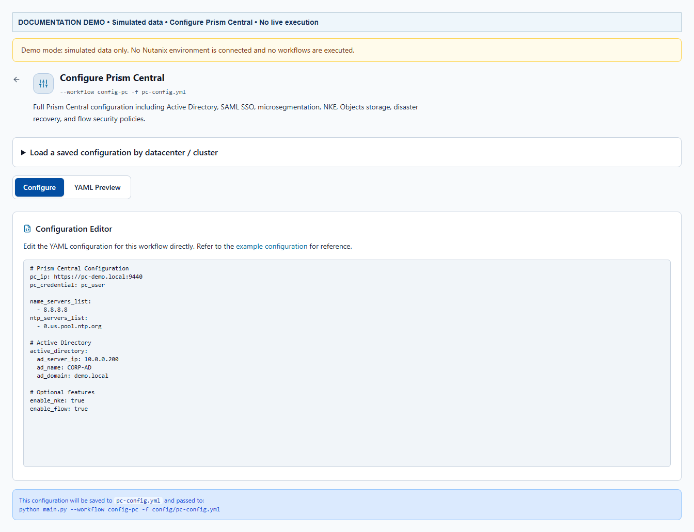

# Configure Prism Central Quick Guide

Guide ID: `QG-W-config-pc` · Reviewed: 21 November 2026 · Source: `48eb875`

Status: Current source procedure. Read [Using the quick guides](../using-the-guides.md) first.

## Purpose

Configures PC: AD, SAML, security policies, NKE, Objects.

## Prerequisites

Use the role authorized by the installed workflow policy. Complete the common preparation checklist, confirm service health and review the impact/recovery plan for this target.

## Required inputs

Configuration filename: `pc-config.yml`. PC endpoint/credential and reviewed native pc-config.yml; directory/SSO/Flow/NKE/Objects prerequisites for only the selected features.

## Procedure

1. Open Workflows 1.x → Configure Prism Central; confirm the ID is config-pc.
2. This entry uses a YAML editor. Replace starter AD and feature examples with the installed framework's supported schema; enable only authorized features and validate before execution.
3. Inspect the full generated/imported YAML, including optional settings and target scope. Save the reviewed file; perform the supported validation before submission.
4. Use the action's required approval and confirmation path. Submit once and follow Jobs / Queue plus any remote service task to its documented completion.

## Validation and expected result

Inspect each selected service, directory/role mapping and PC health; test SSO while retaining a separate administrator session.

## Failure and recovery

The starter enables illustrative features and is not a safe default policy. Partial feature enablement must be reconciled before rerun.

## Evidence to capture

Record the exact target, installed build, reviewed config filename/hash, approval if applicable, job/task/run IDs and redacted before/after checks. Keep unresolved follow-up with the change record.

## References

- [Detailed procedure](../../user-guide.md)
- [Catalogue and details](../../../src/data.ts)
- [Execution form](../../../src/pages/WorkflowDetail.tsx)
- [Guide index](../README.md)

## Screen reference

Simulated initial/authoring view captured 21 November 2026 from application source `48eb875`. State: **Configure / initial draft** at `/workflows/config-pc`. Values are synthetic and required inputs may be incomplete. This is not evidence of a successful run, live target authentication or hardware compatibility. Lower form sections may be outside the captured viewport. Follow the preparation, approval, verification and recovery instructions.
