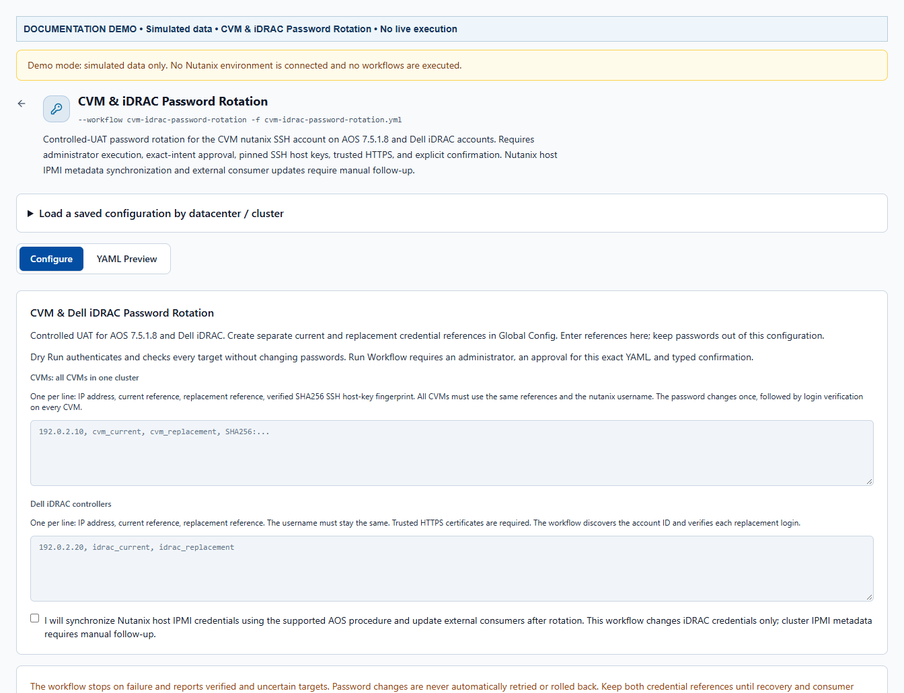

# CVM & iDRAC Password Rotation Quick Guide

Guide ID: `QG-W-cvm-idrac-password-rotation` · Reviewed: 21 November 2026 · Source: `48eb875`

Status: Current source procedure. Read [Using the quick guides](../using-the-guides.md) first.

## Purpose

Rotate CVM SSH and Dell iDRAC passwords with verified logins.

## Prerequisites

Use an Orchestrator administrator. Complete the common preparation checklist, confirm service health and review the impact/recovery plan for this target.

## Required inputs

Configuration filename: `cvm-idrac-password-rotation.yml`. Supported AOS 7.5.1.8 CVMs and Dell iDRAC targets; separate current/replacement references; CVM SSH pins; trusted iDRAC HTTPS; follow-up owner.

## Procedure

1. Open Workflows 1.x → CVM & iDRAC Password Rotation; confirm the ID is cvm-idrac-password-rotation.
2. Review every target and credential username, run the available preflight, obtain exact-intent independent approval and enter the displayed rotation confirmation.
3. Inspect the full generated/imported YAML, including optional settings and target scope. Save the reviewed file; perform the supported validation before submission.
4. Use the action's required approval and confirmation path. Submit once and follow Jobs / Queue plus any remote service task to its documented completion.

## Validation and expected result

Verify replacement logins for every requested account and record per-target results, including any incomplete target.

## Failure and recovery

Controlled UAT only. Preserve old and replacement references during reconciliation. Manually synchronize Nutanix host IPMI metadata and external consumers; do not blindly retry password changes.

## Evidence to capture

Record the exact target, installed build, reviewed config filename/hash, approval if applicable, job/task/run IDs and redacted before/after checks. Keep unresolved follow-up with the change record.

## References

- [Detailed procedure](../../credential-rotation.md)
- [Catalogue and details](../../../src/data.ts)
- [Execution form](../../../src/pages/WorkflowDetail.tsx)
- [Guide index](../README.md)

## Screen reference

Simulated initial/authoring view captured 21 November 2026 from application source `48eb875`. State: **Configure / initial draft** at `/workflows/cvm-idrac-password-rotation`. Values are synthetic and required inputs may be incomplete. This is not evidence of a successful run, live target authentication or hardware compatibility. Lower form sections may be outside the captured viewport. Follow the preparation, approval, verification and recovery instructions.
