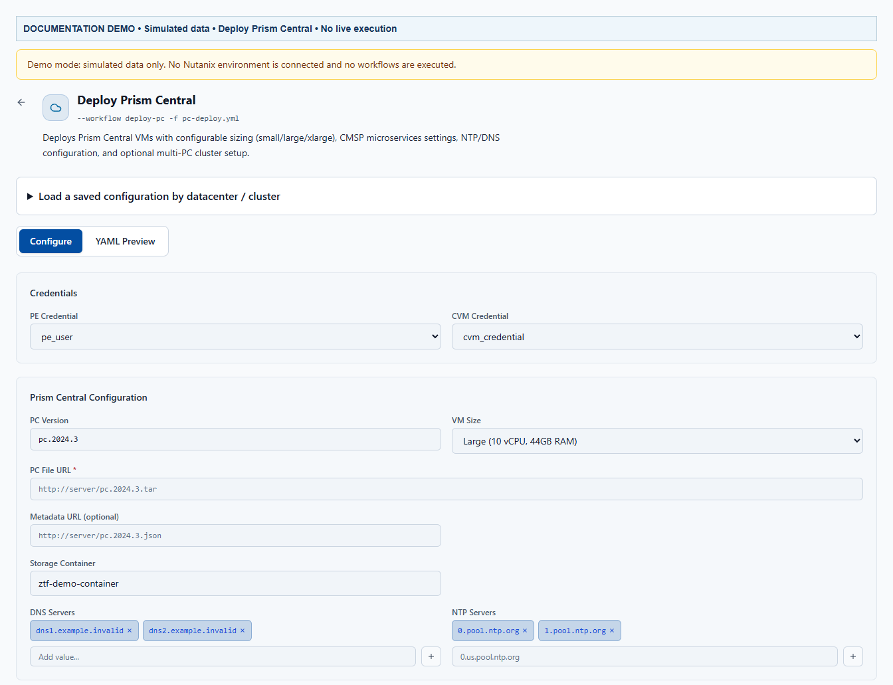

# Deploy Prism Central Quick Guide

Guide ID: `QG-W-deploy-pc` · Reviewed: 20 November 2026 · Source: `79c3ecc`

Status: Current source procedure. Read [Using the quick guides](../using-the-guides.md) first.

## Purpose

Deploys Prism Central VM instances on target clusters.

## Prerequisites

Use the role authorized by the installed workflow policy. Complete the common preparation checklist, confirm service health and review the impact/recovery plan for this target.

## Required inputs

Configuration filename: `pc-deploy.yml`. PE/CVM credentials, PC image and metadata URLs/version, size, VM count, container/network, VIP/node IPs, DNS/NTP, gateway and subnet mask.

## Procedure

1. Open Workflows 1.x → Deploy Prism Central; confirm the ID is deploy-pc.
2. Use the PC deployment form; verify the number of IPs, available capacity and image compatibility. Review software-deletion choices explicitly before approved submission.
3. Inspect the full generated/imported YAML, including optional settings and target scope. Save the reviewed file; perform the supported validation before submission.
4. Use the action's required approval and confirmation path. Submit once and follow Jobs / Queue plus any remote service task to its documented completion.

## Validation and expected result

Verify deployment task completion and PC HTTPS health/identity, version and intended VM membership.

## Failure and recovery

A PC VM existing is not PC service readiness. Inspect partially created VMs and software tasks before retry; do not delete existing software casually.

## Evidence to capture

Record the exact target, installed build, reviewed config filename/hash, approval if applicable, job/task/run IDs and redacted before/after checks. Keep unresolved follow-up with the change record.

## Screen reference

Local demonstration of **Configure / initial draft** at `/workflows/deploy-pc`, captured from source `79c3ecc` on 20 November 2026. Values and credential references are synthetic; required fields may intentionally be incomplete. This is the initial screen or selected configuration panel, not evidence of a successful run. Lower form sections may be outside the captured viewport. Follow this guide's preparation, approval and verification steps.

## References

- [Detailed procedure](../../start-here.md)
- [Catalogue and details](../../../src/data.ts)
- [Execution form](../../../src/pages/WorkflowDetail.tsx)
- [Guide index](../README.md)
