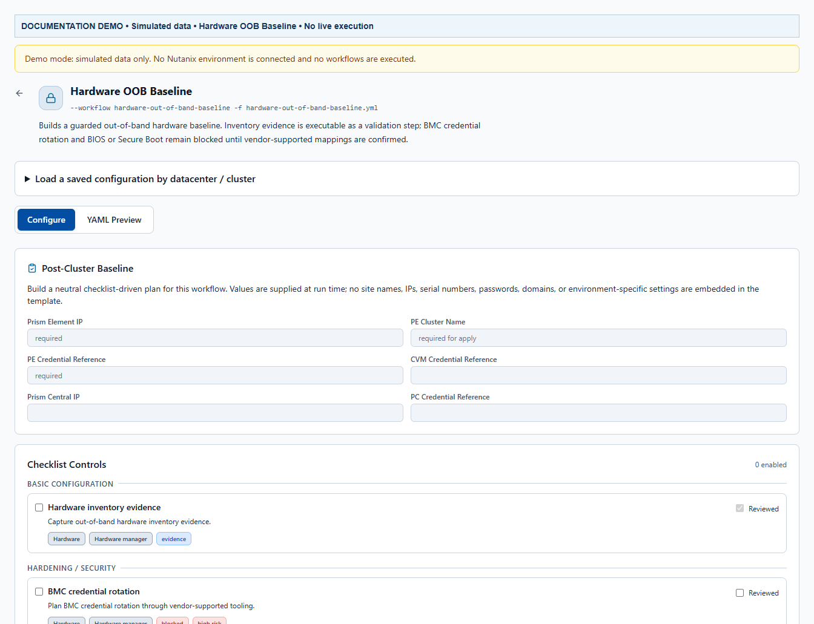

# Hardware OOB Baseline Quick Guide

Guide ID: `QG-W-hardware-out-of-band-baseline` · Reviewed: 21 November 2026 · Source: `48eb875`

Status: Current source procedure. Read [Using the quick guides](../using-the-guides.md) first.

## Purpose

Plans out-of-band hardware baseline tasks through vendor APIs.

## Prerequisites

Use the role authorized by the installed workflow policy. Complete the common preparation checklist, confirm service health and review the impact/recovery plan for this target.

## Required inputs

Configuration filename: `hardware-out-of-band-baseline.yml`. Authorized BMC inventory, hardware identity, credential references, approved vendor baseline and recovery access.

## Procedure

1. Open Workflows 1.x → Hardware OOB Baseline; confirm the ID is hardware-out-of-band-baseline.
2. Capture available inventory evidence and review BMC rotation, BIOS and Secure Boot controls by their displayed mode.
3. Inspect the full generated/imported YAML, including optional settings and target scope. Save the reviewed file; perform the supported validation before submission.
4. Use the action's required approval and confirmation path. Submit once and follow Jobs / Queue plus any remote service task to its documented completion.

## Validation and expected result

Match recorded inventory to the intended node serials; retain separate vendor implementation and validation evidence.

## Failure and recovery

BMC rotation and BIOS/Secure Boot are blocked until vendor-supported mappings exist. Inventory success does not prove configuration compliance.

## Evidence to capture

Record the exact target, installed build, reviewed config filename/hash, approval if applicable, job/task/run IDs and redacted before/after checks. Keep unresolved follow-up with the change record.

## References

- [Detailed procedure](../../production-readiness-boundary.md)
- [Catalogue and details](../../../src/data.ts)
- [Execution form](../../../src/pages/WorkflowDetail.tsx)
- [Guide index](../README.md)

## Screen reference

Simulated initial/authoring view captured 21 November 2026 from application source `48eb875`. State: **Configure / initial draft** at `/workflows/hardware-out-of-band-baseline`. Values are synthetic and required inputs may be incomplete. This is not evidence of a successful run, live target authentication or hardware compatibility. Lower form sections may be outside the captured viewport. Follow the preparation, approval, verification and recovery instructions.
