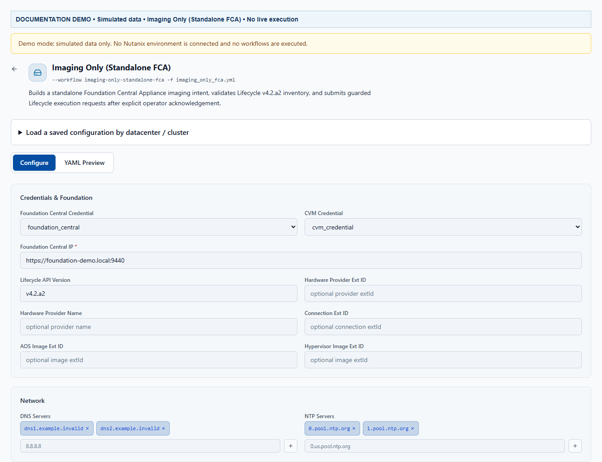

# Imaging Only (Standalone FCA) Quick Guide

Guide ID: `QG-W-imaging-only-standalone-fca` · Reviewed: 21 November 2026 · Source: `48eb875`

Status: Current source procedure. Read [Using the quick guides](../using-the-guides.md) first.

## Purpose

Images nodes through standalone Foundation Central Appliance Lifecycle APIs.

## Prerequisites

Use the role authorized by the installed workflow policy. Complete the common preparation checklist, confirm service health and review the impact/recovery plan for this target.

## Required inputs

Configuration filename: `imaging_only_fca.yml`. Standalone FCA endpoint/credential, eligible Lifecycle inventory, target nodes, imaging batch and approved images.

## Procedure

1. Open Workflows 1.x → Imaging Only (Standalone FCA); confirm the ID is imaging-only-standalone-fca.
2. Review batch membership, run read-only Dry Run and enter RUN STANDALONE-FCA imaging-only-standalone-fca only after the imaging change is approved.
3. Inspect the full generated/imported YAML, including optional settings and target scope. Save the reviewed file; perform the supported validation before submission.
4. Use the action's required approval and confirmation path. Submit once and follow Jobs / Queue plus any remote service task to its documented completion.

## Validation and expected result

Follow the returned FCA deployment ID to terminal completion and verify the intended node images.

## Failure and recovery

Successful handoff is not completed imaging. Verify version-specific Lifecycle submit/status paths; reconcile remote progress before any new submission.

## Evidence to capture

Record the exact target, installed build, reviewed config filename/hash, approval if applicable, job/task/run IDs and redacted before/after checks. Keep unresolved follow-up with the change record.

## References

- [Detailed procedure](../../foundation-central-validation.md)
- [Catalogue and details](../../../src/data.ts)
- [Execution form](../../../src/pages/WorkflowDetail.tsx)
- [Guide index](../README.md)

## Screen reference

Simulated initial/authoring view captured 21 November 2026 from application source `48eb875`. State: **Configure / initial draft** at `/workflows/imaging-only-standalone-fca`. Values are synthetic and required inputs may be incomplete. This is not evidence of a successful run, live target authentication or hardware compatibility. Lower form sections may be outside the captured viewport. Follow the preparation, approval, verification and recovery instructions.
