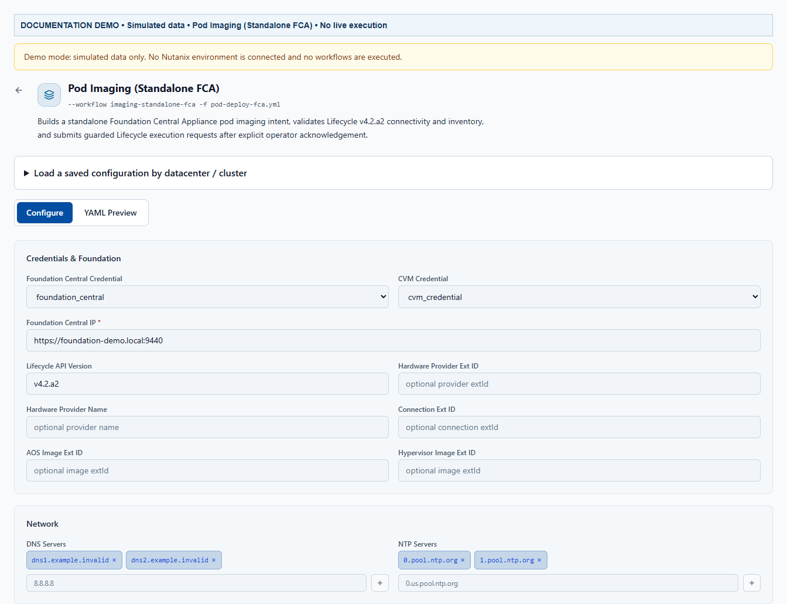

# Pod Imaging (Standalone FCA) Quick Guide

Guide ID: `QG-W-imaging-standalone-fca` · Reviewed: 21 November 2026 · Source: `48eb875`

Status: Current source procedure. Read [Using the quick guides](../using-the-guides.md) first.

## Purpose

Runs pod imaging through standalone Foundation Central Appliance Lifecycle APIs.

## Prerequisites

Use the role authorized by the installed workflow policy. Complete the common preparation checklist, confirm service health and review the impact/recovery plan for this target.

## Required inputs

Configuration filename: `pod-deploy-fca.yml`. Standalone FCA endpoint/credential, imaging batches and approved target inventory for the pod.

## Procedure

1. Open Workflows 1.x → Pod Imaging (Standalone FCA); confirm the ID is imaging-standalone-fca.
2. Use the dedicated imaging form and review every batch. Run read-only Dry Run; the exact acknowledgement is RUN STANDALONE-FCA imaging-standalone-fca.
3. Inspect the full generated/imported YAML, including optional settings and target scope. Save the reviewed file; perform the supported validation before submission.
4. Use the action's required approval and confirmation path. Submit once and follow Jobs / Queue plus any remote service task to its documented completion.

## Validation and expected result

Track each FCA deployment to completion and verify node imaging results rather than relying on the local handoff status.

## Failure and recovery

This catalogue entry supplies imaging_batches. Confirm the intended cluster-creation stage separately; do not infer a completed pod from an imaging handoff.

## Evidence to capture

Record the exact target, installed build, reviewed config filename/hash, approval if applicable, job/task/run IDs and redacted before/after checks. Keep unresolved follow-up with the change record.

## References

- [Detailed procedure](../../foundation-central-validation.md)
- [Catalogue and details](../../../src/data.ts)
- [Execution form](../../../src/pages/WorkflowDetail.tsx)
- [Guide index](../README.md)

## Screen reference

Simulated initial/authoring view captured 21 November 2026 from application source `48eb875`. State: **Configure / initial draft** at `/workflows/imaging-standalone-fca`. Values are synthetic and required inputs may be incomplete. This is not evidence of a successful run, live target authentication or hardware compatibility. Lower form sections may be outside the captured viewport. Follow the preparation, approval, verification and recovery instructions.
