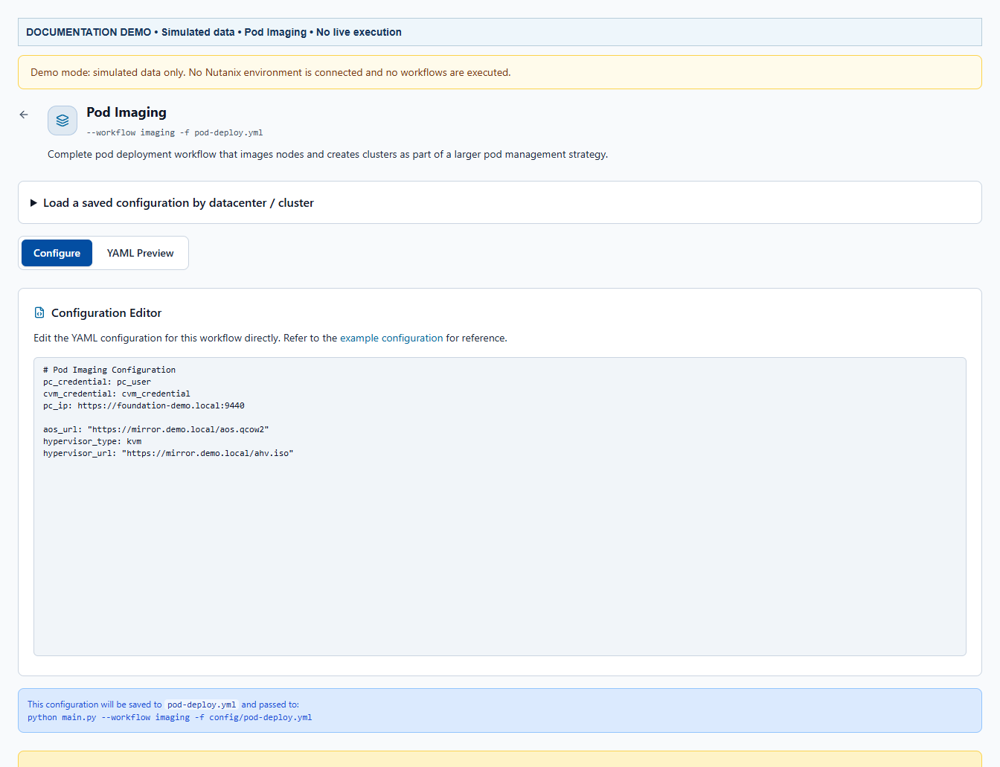

# Pod Imaging Quick Guide

Guide ID: `QG-W-imaging` · Reviewed: 21 November 2026 · Source: `48eb875`

Status: Current source procedure. Read [Using the quick guides](../using-the-guides.md) first.

## Purpose

Pod workflow combining node imaging and cluster creation.

## Prerequisites

Use the role authorized by the installed workflow policy. Complete the common preparation checklist, confirm service health and review the impact/recovery plan for this target.

## Required inputs

Configuration filename: `pod-deploy.yml`. PC-associated Foundation Central endpoint, PC/CVM credential references, pod imaging parameters, approved image URLs and reviewed node scope.

## Procedure

1. Open Workflows 1.x → Pod Imaging; confirm the ID is imaging.
2. This entry uses the YAML editor. Replace its illustrative configuration with the installed framework's reviewed pod-deploy.yml structure. Check the complete pod scope before validation and approved execution.
3. Inspect the full generated/imported YAML, including optional settings and target scope. Save the reviewed file; perform the supported validation before submission.
4. Use the action's required approval and confirmation path. Submit once and follow Jobs / Queue plus any remote service task to its documented completion.

## Validation and expected result

Follow the underlying imaging and cluster tasks for every scoped site; record target serials, PE identities and completion evidence.

## Failure and recovery

The starter YAML is not a complete deployment design. Do not expand an untested batch across a pod; reconcile completed and still-running targets before retry.

## Evidence to capture

Record the exact target, installed build, reviewed config filename/hash, approval if applicable, job/task/run IDs and redacted before/after checks. Keep unresolved follow-up with the change record.

## References

- [Detailed procedure](../../start-here.md)
- [Catalogue and details](../../../src/data.ts)
- [Execution form](../../../src/pages/WorkflowDetail.tsx)
- [Guide index](../README.md)

## Screen reference

Simulated initial/authoring view captured 21 November 2026 from application source `48eb875`. State: **Configure / initial draft** at `/workflows/imaging`. Values are synthetic and required inputs may be incomplete. This is not evidence of a successful run, live target authentication or hardware compatibility. Lower form sections may be outside the captured viewport. Follow the preparation, approval, verification and recovery instructions.
