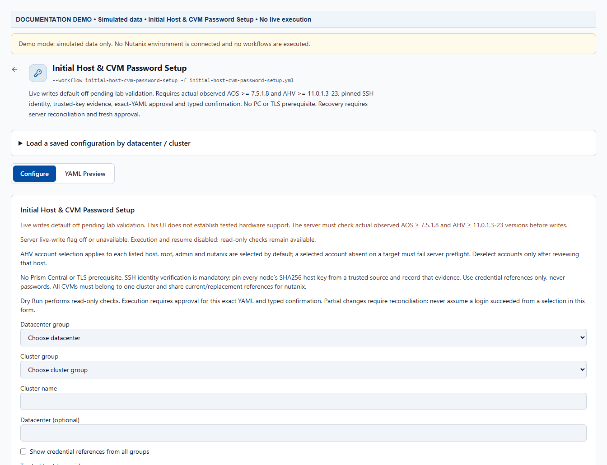

# Initial Host & CVM Password Setup Quick Guide

Guide ID: `QG-W-initial-host-cvm-password-setup` · Reviewed: 20 November 2026 · Source: `79c3ecc`

Status: Current source procedure. Read [Using the quick guides](../using-the-guides.md) first.

## Purpose

Prepare initial AHV account and cluster CVM password setup using credential references.

## Prerequisites

Use an Orchestrator administrator. Complete the common preparation checklist, confirm service health and review the impact/recovery plan for this target.

## Required inputs

Configuration filename: `initial-host-cvm-password-setup.yml`. Every AHV and CVM address; current and replacement credential references; independently verified SSH pins and trusted-key evidence; observed AOS >= 7.5.1.8 and AHV >= 11.0.1.3-23.

## Procedure

1. Open Workflows 1.x → Initial Host & CVM Password Setup; confirm the ID is initial-host-cvm-password-setup.
2. Select applicable AHV accounts; generate reference-only YAML. Run read-only Dry Run, save the exact filename and obtain approval from a different administrator. Type SET INITIAL HOST AND CVM PASSWORDS only for an approved live run.
3. Inspect the full generated/imported YAML, including optional settings and target scope. Save the reviewed file; perform the supported validation before submission.
4. Use the action's required approval and confirmation path. Submit once and follow Jobs / Queue plus any remote service task to its documented completion.

## Validation and expected result

Replacement authentication verifies on every CVM and selected AHV account; retain the durable run ID and per-target results.

## Failure and recovery

Writes default off pending representative lab validation. It creates no accounts and enables no root SSH. Reconcile uncertain writes server-side and obtain fresh approval before resume; appliance rollback does not undo passwords.

## Evidence to capture

Record the exact target, installed build, reviewed config filename/hash, approval if applicable, job/task/run IDs and redacted before/after checks. Keep unresolved follow-up with the change record.

## Screen reference

Local demonstration of **Configure / initial draft** at `/workflows/initial-host-cvm-password-setup`, captured from source `79c3ecc` on 20 November 2026. Values and credential references are synthetic; required fields may intentionally be incomplete. This is the initial screen or selected configuration panel, not evidence of a successful run. Lower form sections may be outside the captured viewport. Follow this guide's preparation, approval and verification steps.

## References

- [Detailed procedure](../../initial-host-cvm-password-setup.md)
- [Catalogue and details](../../../src/data.ts)
- [Execution form](../../../src/pages/WorkflowDetail.tsx)
- [Guide index](../README.md)
