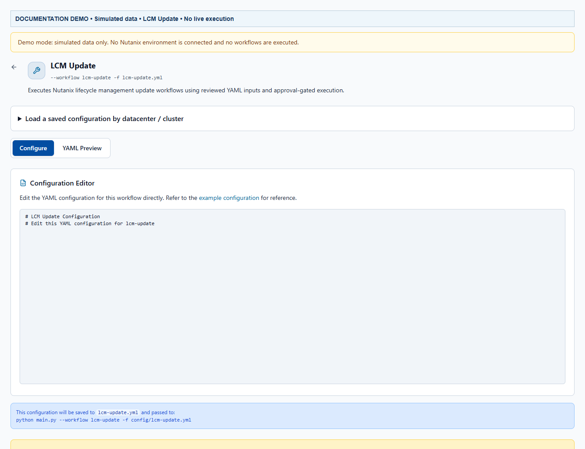

# LCM Update Quick Guide

Guide ID: `QG-W-lcm-update` · Reviewed: 21 November 2026 · Source: `48eb875`

Status: Current source procedure. Read [Using the quick guides](../using-the-guides.md) first.

## Purpose

Runs lifecycle management update workflows.

## Prerequisites

Use the role authorized by the installed workflow policy. Complete the common preparation checklist, confirm service health and review the impact/recovery plan for this target.

## Required inputs

Configuration filename: `lcm-update.yml`. Reviewed lifecycle YAML matching the installed framework, cluster identity, fresh inventory, supported update targets and approved maintenance/recovery plan.

## Procedure

1. Open Workflows 1.x → LCM Update; confirm the ID is lcm-update.
2. This entry uses the YAML editor; its blank starter is not a runnable update configuration. Review vendor compatibility and inventory before requesting an approved update.
3. Inspect the full generated/imported YAML, including optional settings and target scope. Save the reviewed file; perform the supported validation before submission.
4. Use the action's required approval and confirmation path. Submit once and follow Jobs / Queue plus any remote service task to its documented completion.

## Validation and expected result

Follow target LCM tasks to completion, confirm exact component versions, rerun inventory and record cluster health.

## Failure and recovery

Lifecycle updates can disrupt service and may not be reversible. Do not retry from a local timeout until remote LCM state is known.

## Evidence to capture

Record the exact target, installed build, reviewed config filename/hash, approval if applicable, job/task/run IDs and redacted before/after checks. Keep unresolved follow-up with the change record.

## References

- [Detailed procedure](../../post-deployment-checks.md)
- [Catalogue and details](../../../src/data.ts)
- [Execution form](../../../src/pages/WorkflowDetail.tsx)
- [Guide index](../README.md)

## Screen reference

Simulated initial/authoring view captured 21 November 2026 from application source `48eb875`. State: **Configure / initial draft** at `/workflows/lcm-update`. Values are synthetic and required inputs may be incomplete. This is not evidence of a successful run, live target authentication or hardware compatibility. Lower form sections may be outside the captured viewport. Follow the preparation, approval, verification and recovery instructions.
