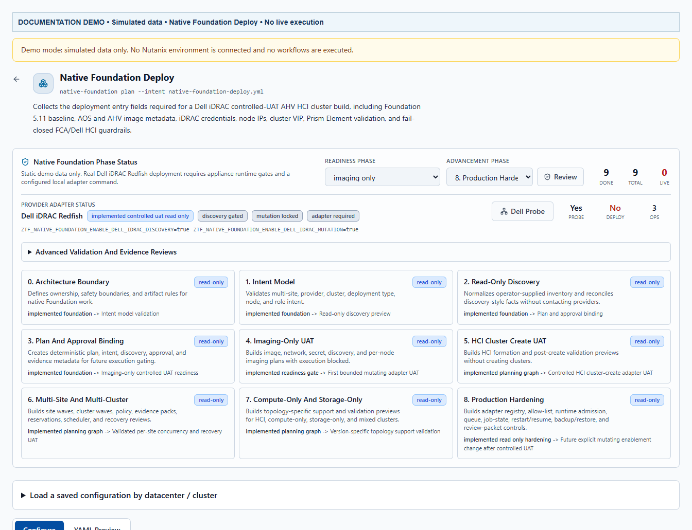

# Native Foundation Deploy Quick Guide

Guide ID: `QG-W-native-foundation-deploy` · Reviewed: 20 November 2026 · Source: `79c3ecc`

Status: Current source procedure. Read [Using the quick guides](../using-the-guides.md) first.

## Purpose

Creates AHV HCI clusters through a native Foundation deployment workflow.

## Prerequisites

Use the role authorized by the installed workflow policy. Complete the common preparation checklist, confirm service health and review the impact/recovery plan for this target.

## Required inputs

Configuration filename: `native-foundation-deploy.yml`. Controlled-UAT Dell iDRAC AHV HCI design, Foundation 5.11 baseline, image versions/checksums, BMC credentials, serials and host/CVM/VIP addressing.

## Procedure

1. Open Workflows 1.x → Native Foundation Deploy; confirm the ID is native-foundation-deploy.
2. Review the dedicated native Foundation form and phase readiness/evidence. Keep planning-only intent until every required hardware, image, network and recovery gate is independently satisfied.
3. Inspect the full generated/imported YAML, including optional settings and target scope. Save the reviewed file; perform the supported validation before submission.
4. Use the action's required approval and confirmation path. Submit once and follow Jobs / Queue plus any remote service task to its documented completion.

## Validation and expected result

Retain the phase report, accepted evidence and any explicitly completed deployment checks; label planned or blocked phases accordingly.

## Failure and recovery

This is a dedicated governed workflow, not the retired Native pipeline executor. Presence in the catalogue does not make all providers or live phases supported; never bypass a blocked gate.

## Evidence to capture

Record the exact target, installed build, reviewed config filename/hash, approval if applicable, job/task/run IDs and redacted before/after checks. Keep unresolved follow-up with the change record.

## Screen reference

Local demonstration of **Configure / initial draft** at `/workflows/native-foundation-deploy`, captured from source `79c3ecc` on 20 November 2026. Values and credential references are synthetic; required fields may intentionally be incomplete. This is the initial screen or selected configuration panel, not evidence of a successful run. Lower form sections may be outside the captured viewport. Follow this guide's preparation, approval and verification steps.

## References

- [Detailed procedure](../../foundation-engine-roadmap.md)
- [Catalogue and details](../../../src/data.ts)
- [Execution form](../../../src/pages/WorkflowDetail.tsx)
- [Guide index](../README.md)
