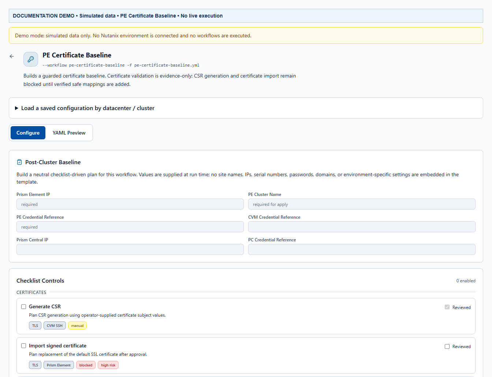

# PE Certificate Baseline Quick Guide

Guide ID: `QG-W-pe-certificate-baseline` · Reviewed: 20 November 2026 · Source: `79c3ecc`

Status: Current source procedure. Read [Using the quick guides](../using-the-guides.md) first.

## Purpose

Plans Prism Element CSR and certificate replacement steps.

## Prerequisites

Use the role authorized by the installed workflow policy. Complete the common preparation checklist, confirm service health and review the impact/recovery plan for this target.

## Required inputs

Configuration filename: `pe-certificate-baseline.yml`. PE identity, certificate design, trusted CA chain and an approved external replacement procedure.

## Procedure

1. Open Workflows 1.x → PE Certificate Baseline; confirm the ID is pe-certificate-baseline.
2. Review certificate-validation evidence. Treat CSR generation and import as blocked controls, then use the separate vendor procedure for any actual replacement.
3. Inspect the full generated/imported YAML, including optional settings and target scope. Save the reviewed file; perform the supported validation before submission.
4. Use the action's required approval and confirmation path. Submit once and follow Jobs / Queue plus any remote service task to its documented completion.

## Validation and expected result

Verify the installed certificate chain, hostname/IP identity and expiry from the intended clients after external replacement.

## Failure and recovery

This baseline does not generate/import a certificate. Do not disable TLS checks to make a certificate evidence item appear complete.

## Evidence to capture

Record the exact target, installed build, reviewed config filename/hash, approval if applicable, job/task/run IDs and redacted before/after checks. Keep unresolved follow-up with the change record.

## Screen reference

Local demonstration of **Configure / initial draft** at `/workflows/pe-certificate-baseline`, captured from source `79c3ecc` on 20 November 2026. Values and credential references are synthetic; required fields may intentionally be incomplete. This is the initial screen or selected configuration panel, not evidence of a successful run. Lower form sections may be outside the captured viewport. Follow this guide's preparation, approval and verification steps.

## References

- [Detailed procedure](../../pe-certificate-trust.md)
- [Catalogue and details](../../../src/data.ts)
- [Execution form](../../../src/pages/WorkflowDetail.tsx)
- [Guide index](../README.md)
