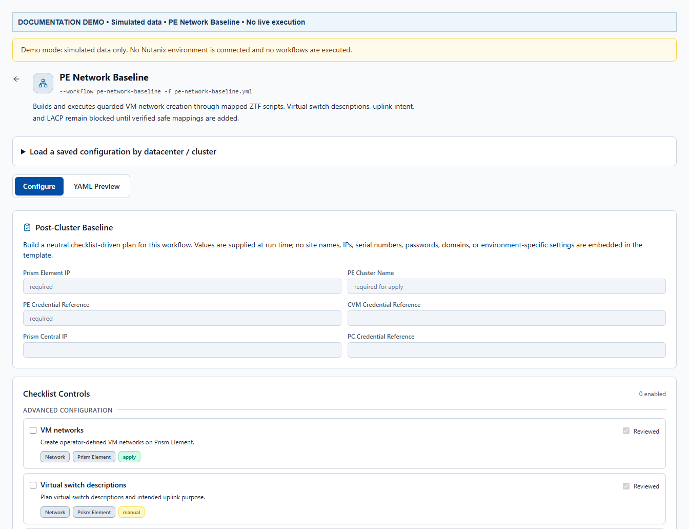

# PE Network Baseline Quick Guide

Guide ID: `QG-W-pe-network-baseline` · Reviewed: 20 November 2026 · Source: `79c3ecc`

Status: Current source procedure. Read [Using the quick guides](../using-the-guides.md) first.

## Purpose

Plans Prism Element virtual switch and VM network settings.

## Prerequisites

Use the role authorized by the installed workflow policy. Complete the common preparation checklist, confirm service health and review the impact/recovery plan for this target.

## Required inputs

Configuration filename: `pe-network-baseline.yml`. PE target, saved credentials, exact network names and VLANs; complete managed IPAM values only when required.

## Procedure

1. Open Workflows 1.x → PE Network Baseline; confirm the ID is pe-network-baseline.
2. Select the mapped VM-network creation control. Review generated networks and compare the Create Subnet (PE) guide before execution. Keep virtual-switch/uplink/LACP intent separate.
3. Inspect the full generated/imported YAML, including optional settings and target scope. Save the reviewed file; perform the supported validation before submission.
4. Use the action's required approval and confirmation path. Submit once and follow Jobs / Queue plus any remote service task to its documented completion.

## Validation and expected result

Confirm each network's VLAN and requested IPAM properties in PE and test the intended guest connectivity.

## Failure and recovery

Virtual-switch descriptions, uplink intent and LACP have no safe mapping here. Prefix-only ip_config is invalid for the legacy subnet runtime; do not run that generated shape.

## Evidence to capture

Record the exact target, installed build, reviewed config filename/hash, approval if applicable, job/task/run IDs and redacted before/after checks. Keep unresolved follow-up with the change record.

## Screen reference

Local demonstration of **Configure / initial draft** at `/workflows/pe-network-baseline`, captured from source `79c3ecc` on 20 November 2026. Values and credential references are synthetic; required fields may intentionally be incomplete. This is the initial screen or selected configuration panel, not evidence of a successful run. Lower form sections may be outside the captured viewport. Follow this guide's preparation, approval and verification steps.

## References

- [Detailed procedure](../../pe-post-configuration-verification.md)
- [Catalogue and details](../../../src/data.ts)
- [Execution form](../../../src/pages/WorkflowDetail.tsx)
- [Guide index](../README.md)
