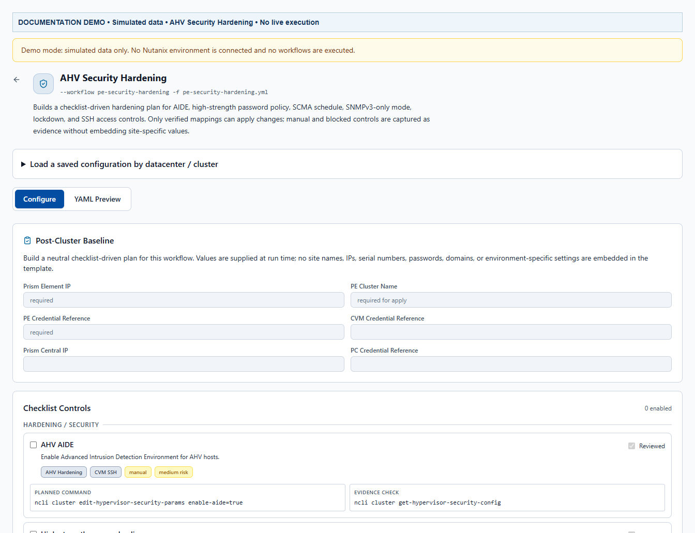

# AHV Security Hardening Quick Guide

Guide ID: `QG-W-pe-security-hardening` · Reviewed: 21 November 2026 · Source: `48eb875`

Status: Current source procedure. Read [Using the quick guides](../using-the-guides.md) first.

## Purpose

Plans post-cluster Prism Element, CVM, and AHV hardening controls.

## Prerequisites

Use the role authorized by the installed workflow policy. Complete the common preparation checklist, confirm service health and review the impact/recovery plan for this target.

## Required inputs

Configuration filename: `pe-security-hardening.yml`. Cluster/CVM/AHV target identity, credential references, approved hardening design and an access-recovery plan.

## Procedure

1. Open Workflows 1.x → AHV Security Hardening; confirm the ID is pe-security-hardening.
2. Review AIDE, password policy, SCMA, SNMPv3-only, lockdown and SSH controls individually. Follow only mapped apply controls; capture evidence for manual/blocked items.
3. Inspect the full generated/imported YAML, including optional settings and target scope. Save the reviewed file; perform the supported validation before submission.
4. Use the action's required approval and confirmation path. Submit once and follow Jobs / Queue plus any remote service task to its documented completion.

## Validation and expected result

Compare each approved control with target-side evidence and confirm the designated recovery access remains usable.

## Failure and recovery

Planning a hardening control does not implement it. Do not run illustrated commands blindly or lock out the maintenance path; use version-specific approved procedures.

## Evidence to capture

Record the exact target, installed build, reviewed config filename/hash, approval if applicable, job/task/run IDs and redacted before/after checks. Keep unresolved follow-up with the change record.

## References

- [Detailed procedure](../../production-readiness-boundary.md)
- [Catalogue and details](../../../src/data.ts)
- [Execution form](../../../src/pages/WorkflowDetail.tsx)
- [Guide index](../README.md)

## Screen reference

Simulated initial/authoring view captured 21 November 2026 from application source `48eb875`. State: **Configure / initial draft** at `/workflows/pe-security-hardening`. Values are synthetic and required inputs may be incomplete. This is not evidence of a successful run, live target authentication or hardware compatibility. Lower form sections may be outside the captured viewport. Follow the preparation, approval, verification and recovery instructions.
