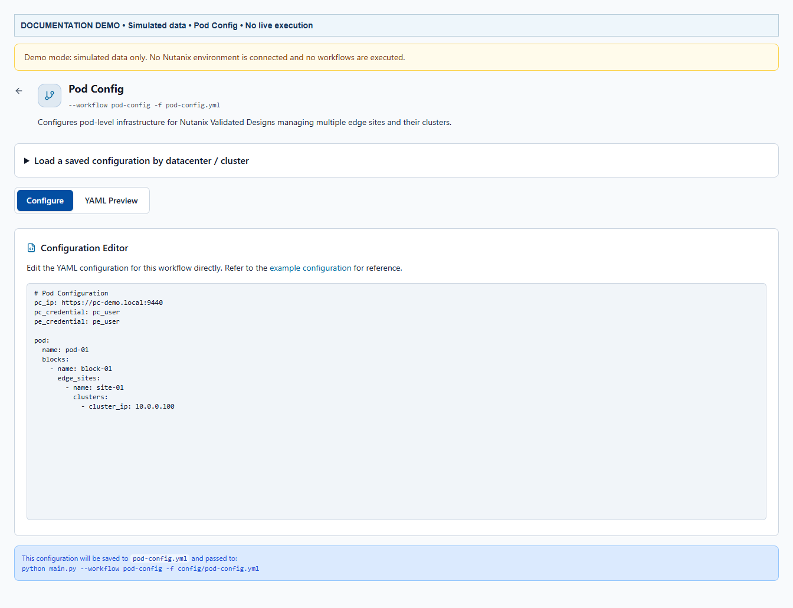

# Pod Config Quick Guide

Guide ID: `QG-W-pod-config` · Reviewed: 21 November 2026 · Source: `48eb875`

Status: Current source procedure. Read [Using the quick guides](../using-the-guides.md) first.

## Purpose

Configures pod and edge site clusters at scale.

## Prerequisites

Use the role authorized by the installed workflow policy. Complete the common preparation checklist, confirm service health and review the impact/recovery plan for this target.

## Required inputs

Configuration filename: `pod-config.yml`. PC/PE credential references and pod, block, edge-site and cluster structure matching the installed framework.

## Procedure

1. Open Workflows 1.x → Pod Config; confirm the ID is pod-config.
2. Use the YAML editor to review exact pod membership and cluster IPs. Validate a representative site configuration before applying the approved wider scope.
3. Inspect the full generated/imported YAML, including optional settings and target scope. Save the reviewed file; perform the supported validation before submission.
4. Use the action's required approval and confirmation path. Submit once and follow Jobs / Queue plus any remote service task to its documented completion.

## Validation and expected result

Verify requested configuration separately for every targeted cluster and record exceptions by site.

## Failure and recovery

The starter pod YAML is only an outline. Do not assume a successful parent job proves all edge sites are reachable or configured.

## Evidence to capture

Record the exact target, installed build, reviewed config filename/hash, approval if applicable, job/task/run IDs and redacted before/after checks. Keep unresolved follow-up with the change record.

## References

- [Detailed procedure](../../user-guide.md)
- [Catalogue and details](../../../src/data.ts)
- [Execution form](../../../src/pages/WorkflowDetail.tsx)
- [Guide index](../README.md)

## Screen reference

Simulated initial/authoring view captured 21 November 2026 from application source `48eb875`. State: **Configure / initial draft** at `/workflows/pod-config`. Values are synthetic and required inputs may be incomplete. This is not evidence of a successful run, live target authentication or hardware compatibility. Lower form sections may be outside the captured viewport. Follow the preparation, approval, verification and recovery instructions.
