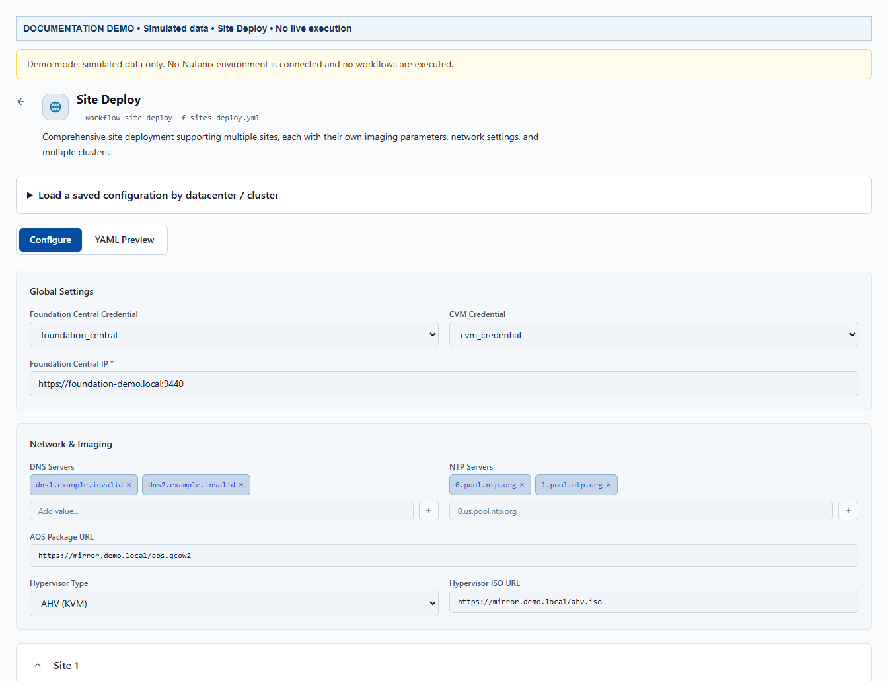

# Site Deploy Quick Guide

Guide ID: `QG-W-site-deploy` · Reviewed: 20 November 2026 · Source: `79c3ecc`

Status: Current source procedure. Read [Using the quick guides](../using-the-guides.md) first.

## Purpose

Full site deployment: imaging, cluster creation, and basic config.

## Prerequisites

Use the role authorized by the installed workflow policy. Complete the common preparation checklist, confirm service health and review the impact/recovery plan for this target.

## Required inputs

Configuration filename: `sites-deploy.yml`. Site names, each site's node/cluster inventory, Foundation connectivity, per-site addressing, images and credential references.

## Procedure

1. Open Workflows 1.x → Site Deploy; confirm the ID is site-deploy.
2. Review one site at a time in the form, then inspect the complete sites YAML. Validate target scope and obtain approval for imaging and initial configuration before execution.
3. Inspect the full generated/imported YAML, including optional settings and target scope. Save the reviewed file; perform the supported validation before submission.
4. Use the action's required approval and confirmation path. Submit once and follow Jobs / Queue plus any remote service task to its documented completion.

## Validation and expected result

Record completion and health per cluster and site; inspect partial failures before continuing to other sites.

## Failure and recovery

A site-wide job can partially complete. Do not rerun the entire site without identifying completed imaging and configuration tasks.

## Evidence to capture

Record the exact target, installed build, reviewed config filename/hash, approval if applicable, job/task/run IDs and redacted before/after checks. Keep unresolved follow-up with the change record.

## Screen reference

Local demonstration of **Configure / initial draft** at `/workflows/site-deploy`, captured from source `79c3ecc` on 20 November 2026. Values and credential references are synthetic; required fields may intentionally be incomplete. This is the initial screen or selected configuration panel, not evidence of a successful run. Lower form sections may be outside the captured viewport. Follow this guide's preparation, approval and verification steps.

## References

- [Detailed procedure](../../start-here.md)
- [Catalogue and details](../../../src/data.ts)
- [Execution form](../../../src/pages/WorkflowDetail.tsx)
- [Guide index](../README.md)
