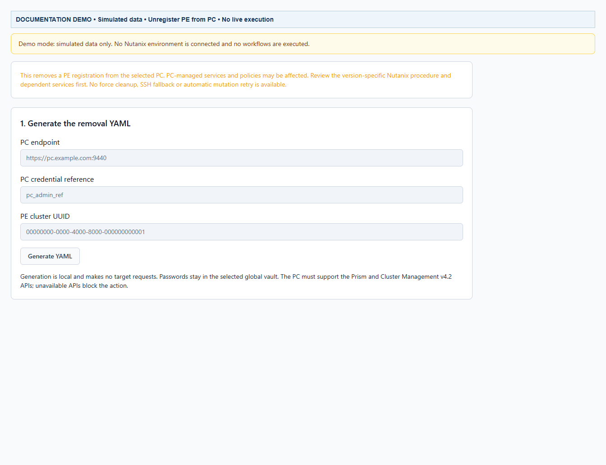

# Unregister PE from PC Quick Guide

Guide ID: `QG-W-unregister-pe-from-pc` · Reviewed: 20 November 2026 · Source: `79c3ecc`

Status: Current source procedure. Read [Using the quick guides](../using-the-guides.md) first.

## Purpose

Review and remove one exact PE registration from Prism Central.

## Prerequisites

Use an Orchestrator administrator. Complete the common preparation checklist, confirm service health and review the impact/recovery plan for this target.

## Required inputs

Configuration filename: `unregister-pe-from-pc.yml`. Trusted PC HTTPS endpoint on port 9440, selected-vault PC credential reference and exact PE cluster UUID; reviewed vendor dependencies.

## Procedure

1. Open Workflows 1.x → Unregister PE from PC; confirm the ID is unregister-pe-from-pc.
2. Select Look up target (read-only). Check captured PC UUID and PE name, acknowledge dependencies and obtain a different administrator's exact-YAML approval. Type UNREGISTER followed by the PE UUID and submit once.
3. Inspect the full generated/imported YAML, including optional settings and target scope. Save the reviewed file; perform the supported validation before submission.
4. Use the action's required approval and confirmation path. Submit once and follow Jobs / Queue plus any remote service task to its documented completion.

## Validation and expected result

A successful PC task and fresh PC inventory show the PE absent. Capture pcInventoryRemovalVerified, peSideCleanupVerified and followupRequired.

## Failure and recovery

PC-side removal does not prove PE cleanup or service health. Reconcile ambiguous tasks before another approval. This action cannot run through script composition, scheduling or pipelines.

## Evidence to capture

Record the exact target, installed build, reviewed config filename/hash, approval if applicable, job/task/run IDs and redacted before/after checks. Keep unresolved follow-up with the change record.

## Screen reference

Local demonstration of **Configure / initial draft** at `/workflows/unregister-pe-from-pc`, captured from source `79c3ecc` on 20 November 2026. Values and credential references are synthetic; required fields may intentionally be incomplete. This is the initial screen or selected configuration panel, not evidence of a successful run. Lower form sections may be outside the captured viewport. Follow this guide's preparation, approval and verification steps.

## References

- [Detailed procedure](../../unregister-pe-from-pc.md)
- [Catalogue and details](../../../src/data.ts)
- [Execution form](../../../src/pages/WorkflowDetail.tsx)
- [Guide index](../README.md)
