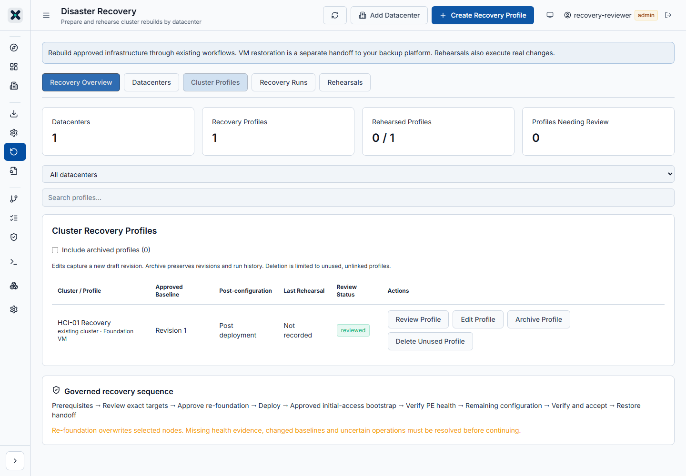

# Recovery profile management

Source update: 5 November 2026, v1.8.5-rc1 prerelease. v1.8.4 remains Latest stable. This capability changes profile management; Foundation imaging, bootstrap, health verification, approvals and configuration execution retain their existing gates.

Simulated browser fixture with generic targets; no infrastructure execution.

## Edit a profile

1. Open **Disaster Recovery > Cluster Profiles** and select the datacenter.
2. Administrators can use **Edit Profile** directly in the table, or **Capture New Revision** in Review Profile.
3. Change the profile name, datacenter, saved Foundation VM configuration or post-deployment pipeline. Save **Draft Revision**.
4. Saving captures a new immutable revision. The previous revision and existing run snapshots remain unchanged. Review the new baseline before preparing another run.

Open runs block editing and archive/restore. The table explains the reason and links to each blocking run. Prepared runs also block changes. To abandon one, open its blocking-run link, expand **Close prepared run without deploying**, type `CLOSE PREPARED <exact cluster name>` and record a reason. This works only before job submission, preserves the snapshot/history and releases the editing blocker. Submitted or uncertain work must use the existing stop/reconciliation process. Only `accepted` and `closed_reconciled` are terminal for this purpose. Unknown future states fail closed. Do not delete records or bypass reconciliation to clear a blocker.

## Archive and restore

1. Select **Archive Profile**. Review the current name and retention explanation.
2. Type `ARCHIVE <exact current profile name>` and provide a reason. Confirm.
3. The profile disappears from default active lists and active-profile counts. Select **Include archived profiles** to inspect its revisions and run history.
4. Archived profiles cannot be edited, marked reviewed or prepared for recovery/rehearsal. Existing managed-cluster links remain visible, marked archived; new links exclude archived profiles.
5. To reactivate, choose **Restore Profile**, type `RESTORE <exact current profile name>` and record a reason. Baseline content and review history are retained. Existing drift and approval checks still apply before execution.

Archiving does not delete YAML, pipelines, credentials, datacenters, revisions, jobs or run history. None of these management actions executes a deployment.

## Delete only an unused profile

**Delete Unused Profile** is available only to an administrator when the server verifies both:

- No recovery or rehearsal run exists for the profile, regardless of status.
- No managed-cluster record references it.

A profile with run history must be archived instead. If managed-cluster metadata cannot be read safely, deletion is unavailable. Review/remove an unnecessary managed-cluster link deliberately before retrying; deletion never silently unlinks a cluster.

Type `DELETE <exact current profile name>` and provide a reason. This permanently removes the unused profile and its draft revisions. Its lifecycle tombstone and global audit remain; configuration files, pipelines and credentials are preserved. Export/retain any required unused baseline first.

## Concurrent changes, permissions and audit

Viewer/operator roles can inspect profiles but cannot edit, archive, restore or delete them. New lifecycle APIs require the exact current revision number and update timestamp, confirmation and notes; stale changes return HTTP 409. Reload and review before retrying. The management UI supplies this metadata on edits too; legacy edit clients remain compatible when they omit both version fields.

Lifecycle events record actor, timestamp, profile identity and reason in optional `profileEvents` metadata (latest 2,000 events retained), with separate global audit events. Managed-cluster link creation and profile deletion share the same in-process lock. This matches the existing single-application process concurrency model; it is not a distributed lock for multiple independent application processes.

The storage format gains optional archive/event metadata without a database migration. Older builds do not enforce the new archive rules: avoid preparing archived profiles after rollback until they are reviewed in a compatible build. Restoring a profile does not itself prove cluster health or recovery readiness.

## Verification without deploying

Use a generic unused test profile with existing non-production saved configuration and pipeline references. Edit it and confirm the revision advances and requires review. Archive it, verify default hiding and archived preparation blocking, then restore it. Verify a profile with any existing run cannot be deleted and that an open run supplies a blocking link. Delete only the unused test profile after reviewing the exact name and reason. Confirm existing configuration files, pipelines and historical runs are unchanged.

Repository tests exercise mocked APIs and browser fixtures. They do not constitute a new physical-cluster recovery rehearsal.
