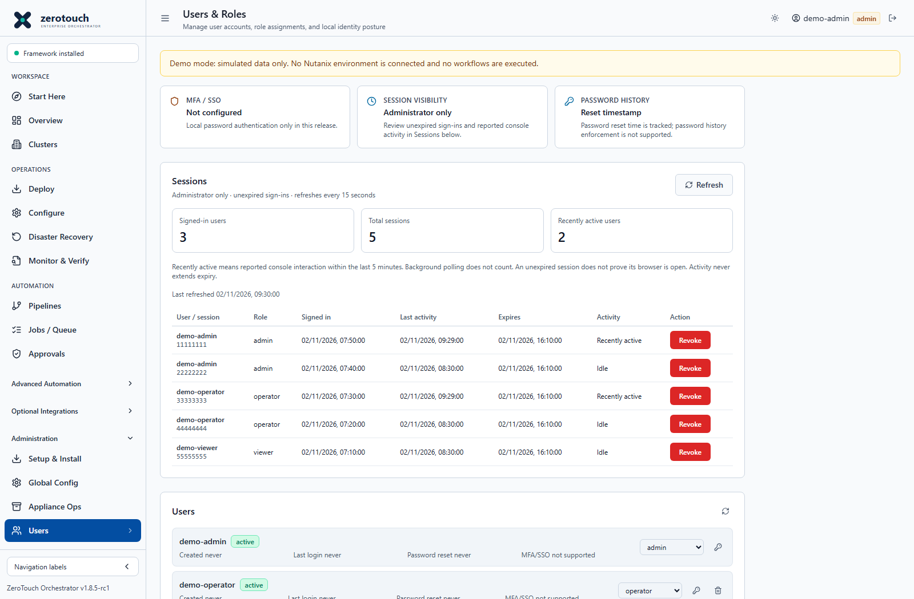
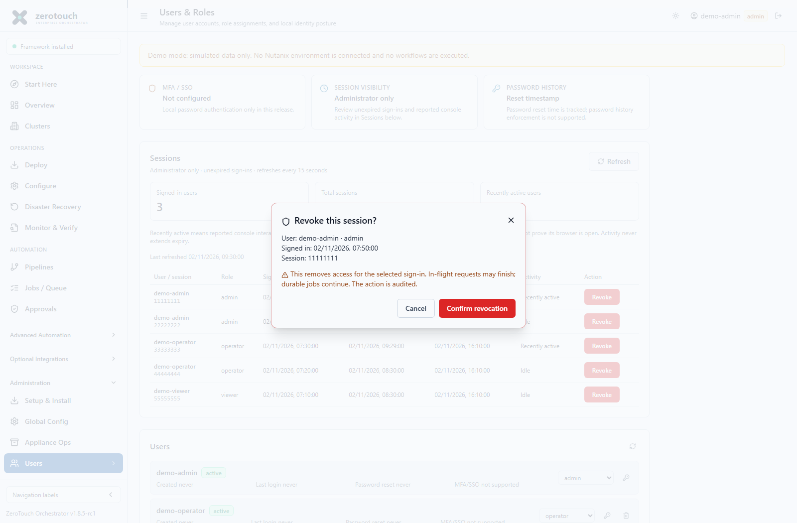

# Session management

Current application baseline: `a3c9c79`; consolidated appliance bundle
`v1.8.5-rc1-636f191`. See [current build and documentation status](current-status.md).

Administrators use **Administration > Users > Sessions** to review sign-ins and
remove one session's future access. This guide describes updated v1.8.5-rc1 source
behavior reviewed on 2 November 2026. It does not establish that an installed
appliance or the immutable original RC package includes the feature. Check the
installed build before relying on these controls. v1.8.4 remains Latest stable.

## What the counts mean

The panel reads the authoritative server session store and includes only records
whose expiry is still in the future. **Signed-in users** counts distinct usernames;
**Total sessions** counts all unexpired sign-ins. One account can have several
sessions. Closing a browser does not necessarily delete its server record, so an
unexpired session does not prove a browser is open or a person is online.

**Recently active users** counts distinct usernames with at least one session
whose recorded activity is within the last **five minutes (300 seconds)**, at the
snapshot's server observation time. The API also provides recently active session
count. A new sign-in records activity at login. After login, the console reports
only explicit browser-trusted `pointerdown` or `keydown` events in a visible tab.
The reporter checks `event.isTrusted` and visibility; it sends no key contents,
pointer coordinates or screen content. It is an activity indicator, not proof of
continuous presence, identity or work completed.

Reports use `POST /api/auth/activity` and are throttled to at most one every
**30 seconds per mounted console reporter**. Interactions within that interval
can be sent later while the tab is visible. Queued interactions older than
**60 seconds** are discarded, so reopening a long-hidden tab cannot replay old
interaction as fresh activity. Separate tabs/reporters are not a
global per-account throttle. Merely opening a tab, returning it to visibility,
reading without clicking/typing, automatic refresh, job-progress polling and other
API requests do not update activity. API clients can explicitly report activity;
the server timestamp is not independent proof of a human interaction.

Neither activity reports nor normal authenticated requests extend expiry.
An idle but unexpired session can still authenticate. Expired records are excluded
from the list even if storage cleanup has not deleted them. No idle-timeout or
sliding-expiry policy is introduced by this panel.

The capture uses generic simulated users; it is not live access evidence.

## Review the panel

1. Sign in with a currently enabled administrator account and open
   **Administration > Users**. Operators and viewers cannot list or revoke sessions.
2. Read all three summary counts and **Last refreshed** before interpreting rows.
   The panel refreshes every **15 seconds while visible**, with a manual **Refresh**
   action. This refresh does not itself count as activity; clicking the action is
   a trusted console interaction and can separately trigger an activity report.
3. Inspect username, sign-in role, signed-in time, last activity, expiry and activity
   status. API times are UTC ISO 8601; the console formats dates in browser local time.
   **This session** marks your current sign-in. The displayed UUID prefix identifies
   a row; it is not a bearer token.
4. Interpret **Recently active**, **Idle** and **Not tracked** conservatively.
   Migrated legacy sessions can have unknown last activity (and memory-only legacy
   records can lack a sign-in timestamp). Null values render **Not tracked**, never
   a fabricated timestamp. They still count as unexpired sessions until expiry or
   revocation. A subsequent explicit report can populate activity.
5. If loading fails, the panel clears its snapshot and shows unavailable counts
   with an error. Retry after checking administrator access and backend version;
   do not interpret unavailable information as zero users.

## Revoke one sign-in

Select **Revoke** on the intended row. Review the account, role, sign-in time and
UUID prefix in the confirmation dialog, then confirm. This deletes only the
selected session, not the account or every sign-in for that username. You can
cancel before confirmation. Revoking **This session** uses **Revoke and sign out**,
clears local authentication and returns this browser to login.

The server checks both the session's administrator role and the current enabled
administrator account. It accepts a canonical UUID, independent of the secret
bearer token. Malformed IDs, expired sessions and already revoked sessions return
**404 Session not found**; refresh before retrying. The listing and revoke response
do not expose bearer tokens. Do not paste tokens into URLs, tickets or screenshots.

Revocation prevents subsequent authenticated requests using that sign-in.
An already authorized **in-flight request may finish**, and **durable jobs continue**.
Revocation is not emergency stop or target-side cancellation. Inspect Jobs / Queue
and target state and use the applicable cancellation/recovery procedure separately.
Removing a sign-in does not prevent the account signing in again; follow account
access and credential procedures for suspected compromise or offboarding.

Successful revocation writes `session_revoked` with action `session.revoke`, acting
administrator, `targetUser`, safe `targetSessionId` and `currentSession`. Review the
structured fields in **Audit Log** and retain the relevant change record without
credentials. This records revocation, not a claim that a running job was stopped.

## API reference

All three routes require bearer authentication. The limits below are separate
server request limits, not the frontend's 30-second reporting throttle.

| Method and route | Access | Result | Server limit |
|---|---|---|---|
| `POST /api/auth/activity` | Any authenticated role | `success: true`; records activity without renewing expiry | 60/minute |
| `GET /api/auth/sessions` | Administrator, with current account recheck | `sessions`, `summary`, `recentActivityWindowSeconds`, `observedAt` | 60/minute |
| `DELETE /api/auth/sessions/<session_id>` | Administrator, with current account recheck | `success: true`, `currentSession` | 30/minute |

Each listed row includes `id`, `username`, `role`, `signedInAt`, `lastActivityAt`,
`expiresAt`, `isCurrent` and `recentlyActive`. Summary fields are `uniqueUsers`,
`totalSessions`, `recentlyActiveUsers` and `recentlyActiveSessions`. The role is
captured at sign-in; do not treat it as a live account-permissions report.
Missing/expired authentication returns 401; insufficient administrator access
returns 403. Server rate limiting can return 429. No bulk-revoke API is added.

## Persistence upgrade and rollback

PostgreSQL stores sessions in `ztf_sessions`. Startup performs an additive,
repeatable migration: add nullable `session_id` and `last_activity_at`, backfill
missing IDs with random UUIDs, and create unique index `idx_ztf_sessions_id`.
Existing tokens, usernames, roles, creation times and expiry values are preserved.
Legacy activity stays null until explicitly reported. New sign-ins record activity
at login. Keep database backups and verify access after startup.

For a compatible prior application image, retain the additive columns/index and
existing session rows. Do not drop or truncate the table to roll back this feature.
An older image has no panel or reporter; a subsequent upgrade assigns IDs to any
new rows missing them. Validate the exact rollback image, health, administrator
login, session access and job state. Database restore is a separate recovery
operation: it can roll back audit/job/account state and resurrect sessions revoked
after the backup, requiring another access review.

File-backed deployments use process-memory sessions, rather than persisting them
with JSON documents. Restart loses those sessions. Do not run multiple application
processes with independent memory stores and assume a shared session inventory.
See [PostgreSQL backend](postgresql-backend.md) and
[backup and restore drill](postgresql-backup-restore-drill.md).

## Manual screenshots and training

The primary [administrator and user manual](manuals/README.md) includes these
procedures. Its Users, Sessions and revocation screenshots were refreshed on 2 November 2026
with generic simulated users without tokens or private values. The static demo uses
simulated sessions and revocation and is not live authentication evidence.
[Video Part 11](user-guide-videos.md) also predates the panel and is retained
unchanged. Follow this written procedure for current behavior.

Foundation VM guidance now uses **Implemented**, replacing the older controlled-UAT
status label. This copy change leaves mutation flags, administrator confirmation,
approvals and target verification requirements intact. Older captures may retain
the previous wording; see [Start Here](start-here.md).

Related: [Administrator guide](admin-guide.md), [User guide](user-guide.md),
[PostgreSQL backend](postgresql-backend.md), [Emergency stop procedure](runbooks/RB-006-emergency-stop.md).
