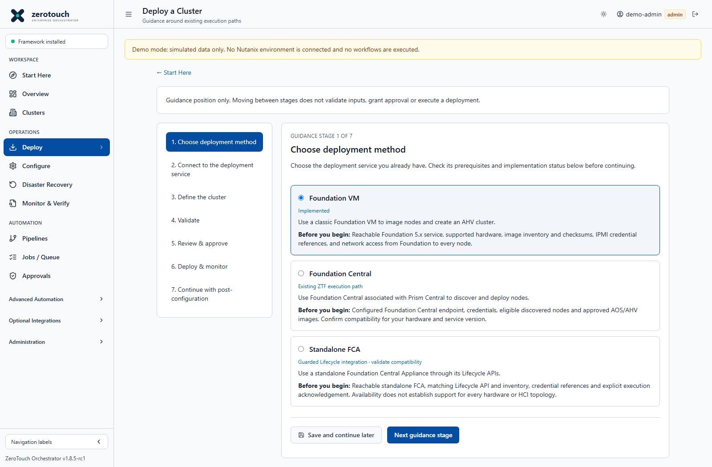
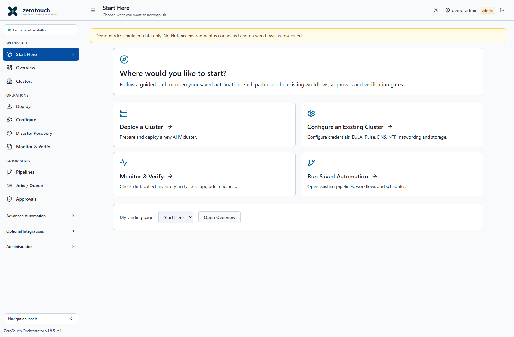

# Start Here and cluster deployment guidance

See [current documented build and update details](current-status.md) for the current source and consolidated appliance status.

Current candidate: **v1.8.5-rc1**. This is navigation around existing execution
paths; it does not add a deployment backend or broaden hardware support.

Follow the [revision 3 deployment process](cluster-deployment-process.md) for
the full design-to-acceptance sequence, including post-configuration gates.

## Choose an outcome

After signing in, users without a landing preference open **Start Here**.
The choices are Deploy a Cluster, Configure an Existing Cluster, Recover
Infrastructure, Monitor & Verify, and Run Saved Automation. The existing dashboard is available
as **Overview** at `/overview`. Choose **My landing page** on Start Here to
prefer Overview. The preference is scoped to the signed-in username and browser;
it does not move to another browser or appliance automatically.

Scripts and YAML Studio remain accessible under **Advanced Automation**.
Native opt-in, NKP and ZTF 2.x console setup/execution are retired; retained
records do not establish an available execution path. See
[console integration retirement](console-retirement.md).

## Foundation VM status label

Updated source guidance labels **Foundation VM** as **Implemented**, removing the
older controlled-UAT qualifier from this established deployment method. Older
screenshots and videos can retain that historical label. This text change does
not change mutation flags, administrator access, exact confirmations, approvals,
image validation or site-specific target verification. It does not promote the
release candidate or expand vendor support.

## Deploy a cluster

Choose the workflow that matches the deployment service available at the site:

| Workflow | When to use it | Required deployment service |
|---|---|---|
| **Cluster Create (Foundation VM)** | Image physical nodes and form an AHV cluster using a classic Foundation VM. Useful for a local or remote site with its own Foundation VM and for approved cluster rebuilds. | Reachable Foundation 5.x service, approved images and Foundation-to-node access. Prism Central is not the imaging service for this path. |
| **Cluster Create** | Use the existing ZTF 1.x Foundation Central path when nodes and images are managed through Foundation Central associated with Prism Central. | Configured Foundation Central endpoint, credentials and eligible discovered nodes. |
| **Cluster Create (Standalone FCA)** | Use a separately deployed Foundation Central Appliance and its Lifecycle APIs instead of the classic Foundation VM or PC-associated Foundation Central path. | Compatible standalone FCA Lifecycle API and inventory; guarded execution and explicit acknowledgement. Validate the actual appliance, hardware and software combination. |

These workflows use different services and configuration schemas; their YAML is
not interchangeable. Node discovery, image readiness, approvals and verification
must be checked in the selected path. **Site Deploy** / **Site Deploy (Standalone
FCA)** are broader site/multiple-cluster workflows; **Imaging Only** prepares nodes
without forming a cluster.

1. Open **Start Here → Deploy a Cluster**. Choose Foundation VM, Foundation
   Central or Standalone FCA. Read the prerequisites and implementation status.
   A listed integration does not certify every hardware or software combination.
2. At **Connect**, open the selected existing workflow. Configure the endpoint,
   credential references and certificate trust, and run its connection/inventory
   checks. A saved endpoint does not establish connectivity.
3. At **Define**, use the workflow form or **Import Config** to prepare nodes,
   addressing, images, checksums and cluster settings. **Download Config** retains
   the actual input file for review or later import.
4. At **Validate**, run **Dry Run** and relevant native payload/image checks in
   that workflow. Resolve reported failures. Coverage differs between workflows;
   do not interpret a generic dry-run pass as complete readiness.
5. At **Review & approve**, inspect exact targets and requested changes in the
   workflow and obtain required approvals for the exact YAML. Imaging may
   overwrite existing installations. The guide does not issue approval.
6. At **Deploy & monitor**, submit from the existing workflow and follow Jobs,
   per-node status, execution logs and recovery controls. Inspect target state
   before retrying a partial deployment.
7. At **Continue with post-configuration**, confirm deployment completion and
   fresh PE health, then open the post-configuration guidance and Pipelines.
   The deployment workflow also offers this guidance link directly.

**Save and continue later** saves only the selected deployment method and guide
position. It stores no endpoints, passwords, credential references or YAML. It
does not save form inputs, validate infrastructure, execute work, or mark a stage
complete. Use the existing configuration download/import and Config Files paths
for actual configuration files. Storage failures are reported rather than shown
as successful saves.

For Foundation VM, **Test IPMI credentials** performs a direct Redfish HTTPS read
from Orchestrator to each BMC. Network failures, timeouts and unavailable Redfish
resources appear as **Unverified**. Authentication or access failures appear as
**Failed**. Foundation VM uses its own network path, so this result alone does
not establish whether Foundation can access the BMCs.

During a pipeline run, the progress header, step rail and log identify each
step by its configuration filename and retain the workflow type. This
distinguishes repeated Configure Cluster steps with different settings.

## Configure and verify

The post-configuration path explains credential preparation, conditional password
change with fresh-login verification, EULA/Pulse, DNS/NTP, supported networking
and storage, optional HA/local users, and explicit verification gates. It links
to Configure Cluster, Scripts, Config Files, Pipelines and Execution History & Logs.
It does not invent a pipeline, select a target, populate an approval, or run any
steps automatically.

**Monitor & Verify** links to Drift Detection, inventory/upgrade readiness and
Execution History & Logs. **Advanced Automation → NKP Validation Evidence** has
a **Preview** badge and retains `/validation-evidence`, existing records,
downloads, NKP readiness and ZTF UAT pack creation. NKP preview evidence does not
verify AHV deployment or PE/PC configuration; retained exports do not replace
fresh infrastructure checks. Existing roles and execution controls are unchanged.

Keep these outcomes separate:

- **Deployment progress:** service and per-node execution status.
- **Configuration completion:** pipeline stage outcomes.
- **Verified readiness:** fresh checks and acceptance evidence.

Viewers can read guidance and open permitted monitoring pages. Execution forms
remain restricted to existing operator/administrator roles, and server-side
execution checks remain authoritative.

## Screen examples

These screenshots were refreshed from the 2 November 2026 isolated static demo
at application baseline `a3c9c79`, with documentation-only demo fixture corrections. They show implemented screens,
not a connected cluster, a completed deployment or production acceptance.

