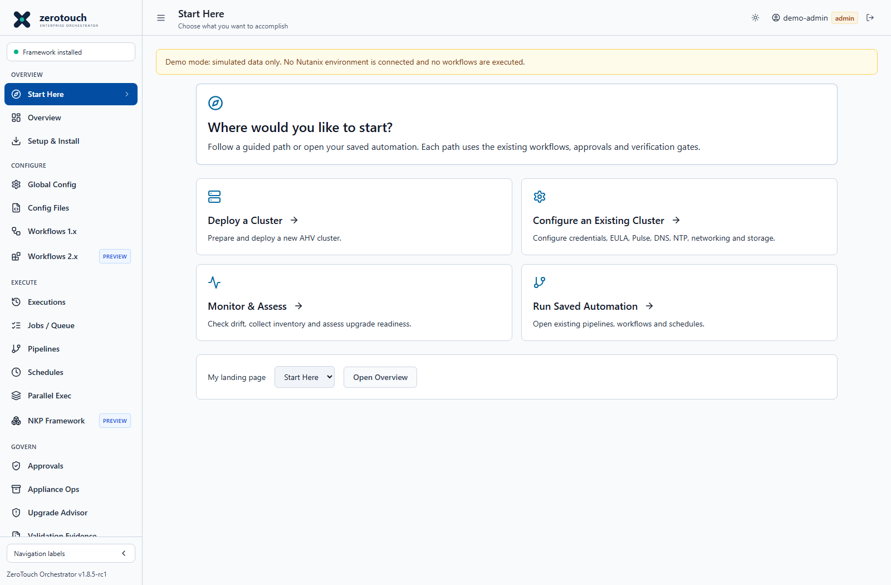
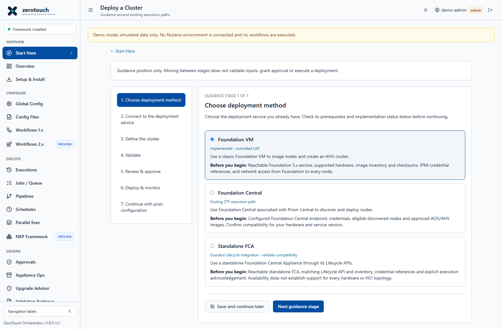

# Start Here and cluster deployment guidance

Current candidate: **v1.8.5-rc1**. This is navigation around existing execution
paths; it does not add a deployment backend or broaden hardware support.

## Choose an outcome

After signing in, users without a landing preference open **Start Here**.
The four choices are Deploy a Cluster, Configure an Existing Cluster,
Monitor & Assess, and Run Saved Automation. The existing dashboard is available
as **Overview** at `/overview`. Choose **My landing page** on Start Here to
prefer Overview. The preference is scoped to the signed-in username and browser;
it does not move to another browser or appliance automatically.

Scripts, YAML Studio and ZTF 2.x IaC remain directly accessible under
**Advanced Automation**. Existing bookmarks and role restrictions remain in place.

## Deploy a cluster

1. Open **Start Here → Deploy a Cluster**. Choose Foundation VM, Foundation
   Central or Standalone FCA. Read the prerequisites and implementation status.
   A listed integration does not certify every hardware or software combination.
2. At **Connect**, open the selected existing workflow. Configure the endpoint,
   credential references and certificate trust, and run its connection/inventory
   checks. A saved endpoint does not establish connectivity.
3. At **Define**, use the workflow form or **Import Config** to prepare nodes,
   addressing, images, checksums and cluster settings. **Download Config** retains
   the actual input file for review or later import.
4. At **Validate**, run **Dry Run** and relevant native payload/image checks in
   that workflow. Resolve reported failures. Coverage differs between workflows;
   do not interpret a generic dry-run pass as complete readiness.
5. At **Review & approve**, inspect exact targets and requested changes in the
   workflow and obtain required approvals for the exact YAML. Imaging may
   overwrite existing installations. The guide does not issue approval.
6. At **Deploy & monitor**, submit from the existing workflow and follow Jobs,
   per-node status, execution logs and recovery controls. Inspect target state
   before retrying a partial deployment.
7. At **Continue with post-configuration**, confirm deployment completion and
   fresh PE health, then open the post-configuration guidance and Pipelines.
   The deployment workflow also offers this guidance link directly.

**Save and continue later** saves only the selected deployment method and guide
position. It stores no endpoints, passwords, credential references or YAML. It
does not save form inputs, validate infrastructure, execute work, or mark a stage
complete. Use the existing configuration download/import and Config Files paths
for actual configuration files. Storage failures are reported rather than shown
as successful saves.

## Configure and verify

The post-configuration path explains credential preparation, conditional password
change with fresh-login verification, EULA/Pulse, DNS/NTP, supported networking
and storage, optional HA/local users, and explicit verification gates. It links
to Configure Cluster, Scripts, Config Files, Pipelines and Validation Evidence.
It does not invent a pipeline, select a target, populate an approval, or run any
steps automatically.

Keep these outcomes separate:

- **Deployment progress:** service and per-node execution status.
- **Configuration completion:** pipeline stage outcomes.
- **Verified readiness:** fresh checks and acceptance evidence.

Viewers can read guidance and open permitted monitoring pages. Execution forms
remain restricted to existing operator/administrator roles, and server-side
execution checks remain authoritative.

## Screen examples

These screenshots were refreshed from the 27 October 2026 isolated static demo
at application revision `4a01072`. They show implemented screens,
not a connected cluster, a completed deployment or production acceptance.

