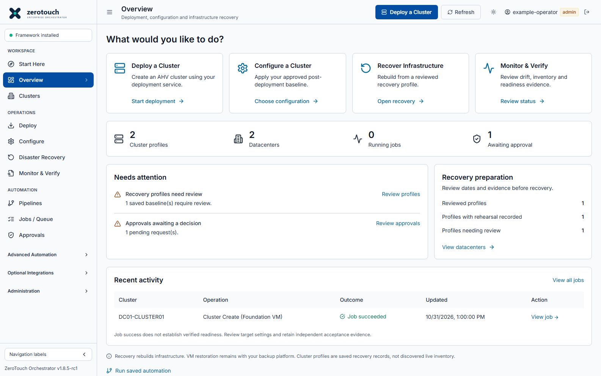

# Streamlined operations console

Overview centres on four tasks: **Deploy a Cluster**, **Configure a Cluster**,
**Recover Infrastructure**, and **Monitor & Verify**. These links open the
existing guidance, workflows and recovery screens. They do not submit work,
grant approval, change a saved configuration or bypass verification.

The summary uses recorded jobs, approvals, drift checks and recovery metadata.
Cluster-profile and datacenter counts come from Disaster Recovery records, not
live discovery. The **Clusters** page filters those saved profiles by datacenter
and name. Other cluster YAML remains accessible in Config Files.

Recent activity says **Job succeeded**, not **Verified**, unless independent
verification has actually been recorded elsewhere. A job link opens that job
in Jobs / Queue. A newer matched drift result supersedes an older result for
the same configuration/workflow in the attention panel. Failed reads show
unavailable/stale guidance rather than asserting that the environment is healthy.

## Existing functionality remains accessible

- **Workspace:** Start Here, Overview and Clusters.
- **Operations:** deployment/configuration guidance, Disaster Recovery and monitoring guidance.
- **Automation:** Pipelines, Jobs / Queue and Approvals.
- **Advanced Automation:** Workflows, Scripts, YAML Studio, Config Files,
  Executions, Schedules, Parallel Exec, Recovery Runs, Rehearsals, Drift Detection,
  Upgrade Advisor and Validation Evidence.
- **Optional Integrations:** NKP Framework, Workflows 2.x, Scripts 2.x and ZTF 2.x IaC.
- **Administration:** Setup & Install, Global Config, Appliance Ops, Users,
  Audit Log and Settings, subject to the existing role restrictions.

The three specialist groups collapse by default and expand when an existing
destination inside them is opened. Their routes, APIs, runtimes and saved data
are retained. Collapsing navigation is a presentation choice, not a server-side
feature-disable or authorization control. Existing bookmarks still work.

All former dashboard panels remain under **Platform details and advanced
operational visibility**. Theme selection, compact/mobile navigation and the
per-user Start Here/Overview landing preference remain available. Existing
execution approvals, exact confirmations and infrastructure validation gates
are unchanged. There is no new backend API, storage migration or dependency.

This source update does not promote the release candidate or establish new
live infrastructure compatibility. Local uncommitted preview images must carry
a distinct local tag and must not be represented as published release bundles.

Screenshot from isolated browser tests, not live infrastructure evidence. The
running console displays its own recorded data; the pictured counts are examples.
