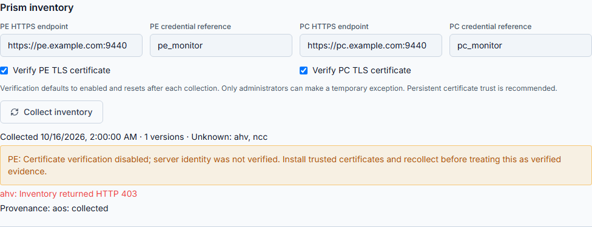

# Upgrade Advisor: temporary TLS exceptions

Upgrade Advisor defaults to verified HTTPS for both Prism Element and Prism
Central. Persistent trust in the approved certificate chain and a matching SAN
identity remains the recommended connection configuration.

## Use the controls

1. Sign in as an administrator and open **Monitor & Verify > Upgrade Advisor**.
2. Enter the PE and optional PC HTTPS endpoint and their credential references.
3. Leave **Verify PE TLS certificate** and **Verify PC TLS certificate** checked
   for normal collection. They are independent controls.
4. If an approved troubleshooting exception is needed, uncheck only the affected
   endpoint. Read the amber warning: both chain validation and hostname/IP
   verification are bypassed. Traffic remains encrypted, but server identity is
   unverified and credentials could be disclosed to an impersonating endpoint.
5. Select **Collect inventory**. This issues only the existing bounded GET
   requests. It does not update either cluster or execute an upgrade.
6. Both controls reset to checked after success or failure. An exception is not
   stored as a connection preference. A failed request may still have sent
   credentials; the reset is for the next request, not a reversal of that request.
7. Review the returned errors and amber inventory warning. Correct certificate
   trust and collect again with verification enabled before relying on verified
   inventory evidence. HTTP authentication/authorization and API failures remain
   failures even with certificate verification disabled.
8. Run and save the assessment. Reopening it retains its inventory TLS status and
   warning even though the next-collection controls are checked. JSON and Markdown
   assessment exports include the recorded TLS verification state. An assessment
   readiness result is separate from proof of trusted server identity.

Operators can collect inventory only with TLS verification enabled. Their TLS
controls are checked and disabled; the API independently rejects exceptions with
HTTP 403. Viewers cannot collect. Other workflows, live PE drift and health
collection retain their existing TLS policies.

## Audit and API contract

`POST /api/upgrade-advisor/inventory` accepts optional Boolean `peVerifyTls` and
`pcVerifyTls` fields. Omission means true; strings, numbers and null are rejected.
An exception requires the corresponding endpoint. No global SSL configuration is
changed, and redirects, proxies, response bounds and timeouts remain unchanged.

The audit action `upgrade_inventory_tls_exception` records user, PE/PC flags and
requested/denied outcome before an exception collection is attempted. Collection
records retain `tlsVerification` and `securityWarnings`; they do not contain
passwords, authorization headers or raw TLS exceptions. Saving an assessment binds
those records through its server-side inventory snapshot ID.

Older saved assessments may have no TLS metadata; absence is not newly collected
verification evidence. Existing dated manual/screenshots retain their provenance;
this addendum describes the new request-scoped exception controls.

## Illustrated saved evidence

[Capture provenance](assets/upgrade-advisor/README.md): generic simulated data; no live infrastructure calls.
